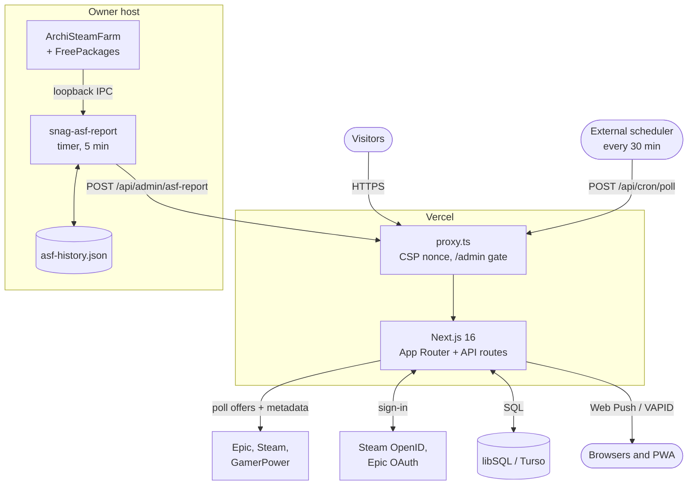
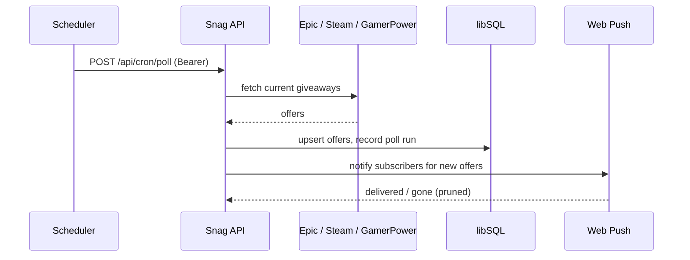

<div align="center">

<a href="https://snag.mdprana.site">
  <picture>
    <source media="(prefers-color-scheme: dark)" srcset="public/logo.svg">
    
  </picture>
</a>

<br><br>

**Good games. Zero price tag.**

Free-game discovery for **Epic Games Store** and **Steam**, with claim windows, one-tap store links and push alerts.

<br>

[](https://snag.mdprana.site)

      

[Features](#features) · [Architecture](#architecture) · [Quick start](#quick-start) · [Configuration](#configuration) · [Checks](#checks) · [Self-hosting](#deployment-and-self-hosting)

</div>

---

## Features

| Feature | What it does |
| --- | --- |
| **One feed** | Limited-time giveaways from Epic, Steam and GamerPower in one database-backed feed, with UTC claim windows. |
| **Game pages** | Store metadata, About text, screenshots and trailers, with honest fallbacks when store data is missing. |
| **One-tap claim** | Opens the official store page and tracks what you claimed per account. Snag never claims for public users. |
| **Accounts** | Steam sign-in, optional Epic sign-in (off by default), logout and self-service account deletion. |
| **Push alerts** | Installable PWA with per-store notification preferences, device subscriptions and test notifications. |
| **Owner status** | `/admin` shows ASF bot status, the last 20 free license claims and latest offer polls. Everyone else gets HTTP 404. |
| **Hardened** | Nonce-based CSP, origin checks, rate limiting, strict input schemas and redacted logs. |

## Architecture



- **Polling** runs on an external scheduler. Each source is stored separately, and the last known offers stay when a source fails.
- **The ASF reporter** reads ASF over loopback IPC and sends only a bounded summary: online flag plus up to 20 parsed claims. The web host never connects to IPC.
- **Owner gate**: `proxy.ts` checks the session against `OWNER_STEAMID64` before `/admin` renders, so non-owners get a real 404 with no owner data.

## Request flow



> **Verification limits.** Unit and browser tests use fixtures, not live accounts. Steam sign-in, push and ASF claiming have owner-reported success on the live deployment, not a check on every device. Epic sign-in needs provider approval. Docker examples are untested.

## Quick start

Requires **Node.js 22.18+** and npm. Run commands from the project root.

```sh
npm ci
cp .env.example .env
```

Fill in the required values in `.env`. Keep `EPIC_LOGIN_ENABLED=false` while developing without Epic credentials.

Generate development VAPID keys:

```sh
node --input-type=module -e "import * as webpush from 'web-push'; console.log(webpush.generateVAPIDKeys())"
```

Copy `publicKey` into `NEXT_PUBLIC_VAPID_PUBLIC_KEY` and `privateKey` into `VAPID_PRIVATE_KEY`. Set `VAPID_SUBJECT` to your contact URI, such as `mailto:you@example.com`.

Generate a separate cron secret and copy the output into `CRON_SECRET`:

```sh
node -e "console.log(require('node:crypto').randomBytes(32).toString('hex'))"
```

Initialize the database, then start development:

```sh
npm run db:migrate
npm run dev
```

Open **https://localhost:3100**. Development uses a local HTTPS certificate, so your browser may show a certificate warning. Only trust a certificate you generated locally.

These settings are required by the current validator even when push and cron are not being exercised. Never commit `.env`, credentials or database files.

## Configuration

Template: [`.env.example`](.env.example). Validator: [`src/lib/env.ts`](src/lib/env.ts).

| Variable | Purpose |
| --- | --- |
| `APP_URL` | Required HTTPS origin without a path or trailing slash. Local default: `https://localhost:3100`. |
| `DATABASE_URL` | Required database connection. Local default: `file:snag.db`. |
| `DATABASE_AUTH_TOKEN` | Optional remote database credential. |
| `NEXT_PUBLIC_VAPID_PUBLIC_KEY` | Required public VAPID key, intended for browser use. |
| `VAPID_PRIVATE_KEY` | Required private VAPID key, server-side only. |
| `VAPID_SUBJECT` | Required `mailto:` or `https://` contact URI. |
| `CRON_SECRET` | Required random secret, at least 32 characters. |
| `ASF_REPORT_SECRET` | Optional reporting secret, at least 32 characters when set. |
| `OWNER_STEAMID64` | Optional owner identifier, exactly 17 digits. |
| `EPIC_LOGIN_ENABLED` | Optional; only exact `true` enables login. Keep `false` until provider approval, configuration and testing. |
| `EPIC_CLIENT_ID` / `EPIC_CLIENT_SECRET` | Required when `EPIC_LOGIN_ENABLED=true`. Keep the secret server-side. |

Presence checks do not verify provider access or key validity. Configuring a variable does not make its associated feature ready.

## Checks

```sh
npm test
npm run lint
npx tsc --noEmit
npm run build
```

Unit tests use fixtures and mocked provider responses; they do not verify live provider access or push delivery. Browser checks cover responsive layouts, CSP, artwork, trailer behavior and owner access using synthetic fixtures, not live integration. Browser tests require Playwright Chromium. Run `npx playwright test` for local HTTPS development checks, or build first and run `PLAYWRIGHT_PRODUCTION=1 npx playwright test` for production checks on HTTPS port 3113. Set `PLAYWRIGHT_BROWSERS_PATH` if your browser installation uses a custom location. Tests recreate a disposable fixture database, never the configured application database. Run `node ops/asf-report.check.mjs` for the reporter's isolated self-check.

Additional dependency and secret checks:

```sh
npm run check:audit
npm run check:secrets
```

The secret check requires `gitleaks`; without it, the command reports a skip. A skip is not a clean scan.

## Structure

```text
app/                    Pages, API routes, application layout and styles
src/components/         Feed, account and notification UI
src/lib/                Database, auth, polling, push and security utilities
db/migrations/          Versioned SQL migrations
scripts/migrate.ts      Migration runner
tests/                  Unit tests and provider-response fixtures
e2e/                    Local Playwright browser tests
proxy.ts                Content Security Policy and security headers
```

## Deployment and self-hosting

Before accepting public accounts, verify the intended deployment's provider callbacks and push delivery, configure HTTPS and a scheduler, and identify the operator, processors, privacy contact and backup-retention policy. Account deletion in Settings requires typing `DELETE`; it removes account-linked records from the active database, not operator backups or store accounts.

### Offer scheduler

Configure an external scheduler to POST `/api/cron/poll` every 30 minutes, with `Authorization: Bearer <CRON_SECRET>`. GET returns 405; missing or wrong bearer returns 401. There is no built-in scheduler. A poll can send real notifications, so never point development checks at a live instance.

With `APP_URL` and `CRON_SECRET` loaded securely into the operator shell, a manual trigger is:

```sh
curl --fail --silent --show-error --max-time 120 --request POST \
  --header "Authorization: Bearer ${CRON_SECRET}" "${APP_URL}/api/cron/poll"
```

Do not enable shell tracing or log request headers. Check offer freshness and source status after failures; retained offers are not proof of a successful latest poll.

### Optional owner reporter

Templates: [`ops/asf-report.env.example`](ops/asf-report.env.example), [`ops/snag-asf-report.service`](ops/snag-asf-report.service), [`ops/snag-asf-report.timer`](ops/snag-asf-report.timer). These files do not install or configure ASF and are not activated by the app.

The web app needs `OWNER_STEAMID64` and a separate random `ASF_REPORT_SECRET` of at least 32 characters. Sign in through that Steam identity to view `/admin`. The local reporter needs:

| Variable | Reporter requirement |
| --- | --- |
| `APP_URL` | Exact HTTPS Snag origin, no trailing slash. |
| `ASF_IPC_URL` | Optional, defaults to `http://127.0.0.1:1242`; only literal `127.0.0.1` or `[::1]`, HTTP/HTTPS, root path, no credentials/query/fragment. |
| `ASF_BOT` | Exact bot name, 1-64 letters, digits, underscores or hyphens. |
| `ASF_IPC_PASSWORD` | Existing private IPC password, at least 32 characters. Never send it to Snag. |
| `ASF_REPORT_SECRET` | Same separate report secret as the web app, at least 32 characters. |
| `ASF_REPORT_STATE` | Optional claim history file, defaults to `$HOME/.local/state/snag/asf-history.json`. |

On the ASF host, store reporter configuration in a private directory with mode 700 and the environment file with mode 600. Keep ASF configuration files mode 600 and Steam Guard enabled. Review the service template's Node path, checkout path and environment-file path before separately installing user units. The template expects the checkout at `%h/snag` (adjust `WorkingDirectory`/`ExecStart` if yours differs) and configuration at `%h/.config/snag/asf-report.env`. No service installation or activation is performed by the quick start.

A deliberate manual run, only after reviewing configuration, uses Node's environment-file support:

```sh
node --env-file="$HOME/.config/snag/asf-report.env" ops/asf-report.mjs
```

The timer template sends every five minutes. Every HTTP call has a ten-second timeout and rejects redirects; each IPC response is capped at 1 MiB of JSON. Reporter reads `IsConnectedAndLoggedOn` from `GET /Api/Bot/<ASF_BOT>`, then the last 500 lines from `GET /Api/NLog/File?count=500`. Only FreePackages lines for the configured bot that exactly match `ClaimFreeSub() ID: sub/N | Status: A/B` or `ClaimFreeApp() ID: app/N | Status: A/B` are kept; every other line is ignored and raw lines are never sent. Log times are host local time and are converted to UTC.

ASF clears its log file on restart, so the reporter keeps merged, deduplicated claims in a local state file: `ASF_REPORT_STATE`, default `$HOME/.local/state/snag/asf-history.json` (directory mode 700, file mode 600), newest first, at most 20. Create the directory once with `mkdir -p -m 700 ~/.local/state/snag` before starting the service; the template grants write access only there through `ReadWritePaths`. If the log request fails, the last saved history is sent; with no saved state, history is `"unavailable"`.

Sent body: `{ "online": <boolean>, "history": [{ "at": "<UTC ISO time>", "kind": "sub" | "app", "id": <number>, "result": "<A>/<B>" }, ...] }`, or `"history": "unavailable"`. Intake permits at most 8 KiB and 30 authenticated requests per minute, rejects unknown fields and keeps only the latest report. Reports older than 15 minutes show as stale. `/admin` labels a claim Success when its result starts with `OK/`, otherwise Failed; history covers only claims logged since the reporter started keeping state. Reporter never issues claim commands or uploads raw IPC responses, bot names, credentials or raw log lines. See [ASF IPC documentation](https://github.com/JustArchiNET/ArchiSteamFarm/wiki/IPC); verify compatibility with your installed version before activation. Keep IPC loopback-only; never expose it to the internet or make the web host contact it.

### Database backup and restore

There is no bundled backup script. For a local SQLite database, use SQLite's online backup command rather than copying an active database file. Example assumes `DATABASE_URL=file:snag.db`, a private backup directory and an installed `sqlite3` CLI:

```sh
umask 077
mkdir -p backups
chmod 700 backups
sqlite3 snag.db ".backup 'backups/snag.sqlite3'"
sqlite3 backups/snag.sqlite3 'PRAGMA integrity_check;'
chmod 600 backups/snag.sqlite3
```

Encrypt backups and transfer them to restricted storage. Keep credentials separately protected. Define retention: backups contain identities and push subscriptions, including records deleted after the snapshot. For remote libSQL/Turso, use your provider's documented consistent backup/restore workflow instead; these local-file commands do not back up a remote database.

To restore, stop your app and scheduler through your own process manager first. Preserve the current database and its WAL/SHM files as a rollback set. Restore to a new file, not over an active database:

```sh
sqlite3 backups/snag.sqlite3 'PRAGMA integrity_check;'
sqlite3 restored-snag.db ".restore 'backups/snag.sqlite3'"
chmod 600 restored-snag.db
sqlite3 restored-snag.db 'PRAGMA integrity_check;'
```

Set `DATABASE_URL=file:restored-snag.db` in your protected runtime configuration, run `npm run db:migrate`, then restart your app and verify sign-in, feed and account deletion before re-enabling the scheduler. Restoring also restores old sessions/subscriptions; review revocation and deletion obligations before resuming traffic. These are operator recipes, not a tested disaster-recovery certification.

### Optional claiming tools: untested examples

The `/self-host` page contains fuller setup and safety notes. These third-party tools require your own credentials on your own **always-on machine** (home PC, compatible Raspberry Pi or VPS). Check image CPU support and allow about 2 GB RAM plus OS headroom for Epic’s browser. They do not connect to Snag or report claims to it.

The following Compose example has **not been deployment-tested**. Review upstream instructions for [ArchiSteamFarm](https://github.com/JustArchiNET/ArchiSteamFarm/wiki/Docker), [Citrinate/FreePackages](https://github.com/Citrinate/FreePackages) and [epicgames-freegames-node](https://github.com/claabs/epicgames-freegames-node). Pin reviewed image digests before unattended use and verify plugin compatibility.

In a private directory outside this checkout:

```sh
umask 077
mkdir -p asf/config asf/plugins epic/config
```

Save as `compose.yaml`:

```yaml
services:
  asf:
    image: justarchinet/archisteamfarm:latest
    restart: unless-stopped
    stdin_open: true
    tty: true
    volumes:
      - ./asf/config:/app/config
      - ./asf/plugins:/app/plugins
  epic:
    image: ghcr.io/claabs/epicgames-freegames-node:latest
    restart: unless-stopped
    init: true
    shm_size: 1gb
    mem_limit: 2g
    ports:
      - "127.0.0.1:3300:3000"
    volumes:
      - ./epic/config:/usr/app/config
```

Before starting, save `{"IPC":false}` as `asf/config/ASF.json`. No ASF ports are published: keep IPC disabled. Install a trusted, compatible FreePackages release under `asf/plugins/FreePackages`, preserve its license notices, and configure your bot using upstream instructions. Enable `EnableFreePackages`; review filters such as `Types: ["Game"]`, `NoCostOnly: true` and `IgnoreFreeWeekends: true`. Enter credentials and Steam Guard only on your own machine; interactive prompts can use `docker compose attach asf` (detach with Ctrl-P, Ctrl-Q).

Configure `epic/config/config.json` from upstream instructions, with a notifier you control and `webPortalConfig.baseUrl` pointing to the loopback helper. Keep public tunneling disabled. For remote access, use an authenticated SSH tunnel, not a public port. Epic may require manual device login, checkout or CAPTCHA; unattended claiming is not guaranteed.

```sh
docker compose config --quiet
docker compose up -d
docker compose logs --tail=50
docker compose down
```

Logs and bind mounts may contain credentials, sessions or login links. Restrict directory access, never use `chmod 777`, and never commit these files. Use Steam Guard and Epic 2FA. Back up bind-mounted directories securely while stopped; `docker compose down` preserves them. Define encrypted-backup retention. Back up before pulling updates and check plugin compatibility after upgrades. Automation may fail or conflict with account terms; review upstream guidance before use.

## Provider disclaimer

Snag is independent and is not affiliated with Epic Games, Valve or GamerPower. Store names, trademarks and game assets belong to their respective owners. Offer availability, regional eligibility and claim requirements are controlled by the provider.

---

<div align="center"><sub>Built by <a href="https://github.com/mdprana">Made Pranajaya Dibyacita</a></sub></div>
